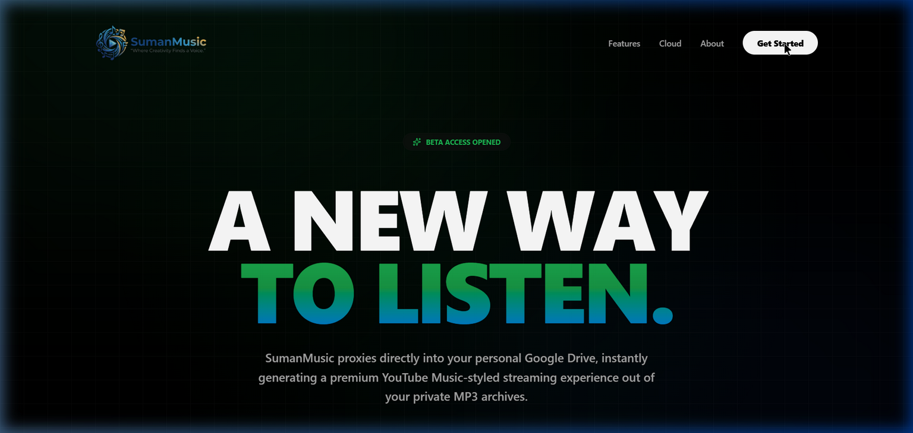
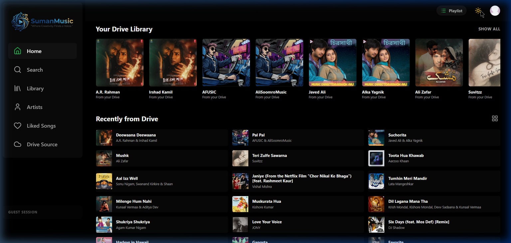
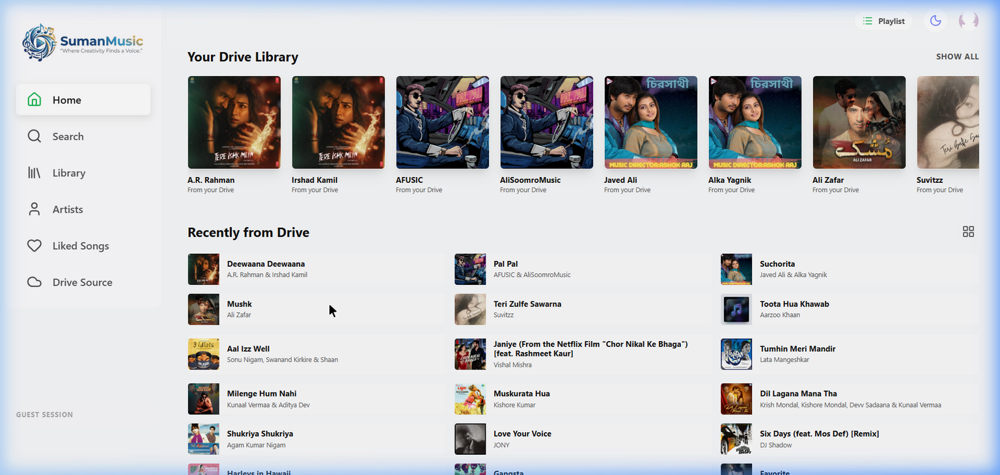
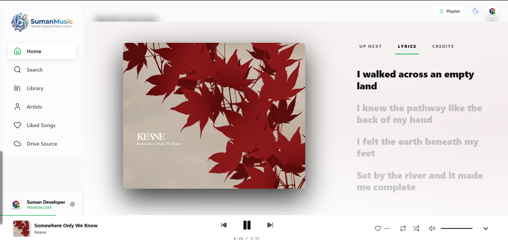
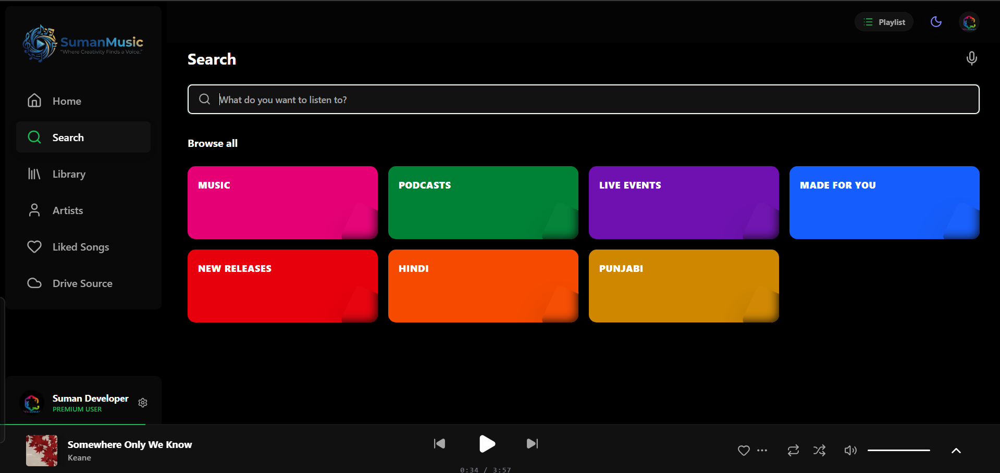

<div align="center">


# SumanMusic

**A modern, cloud-native music streaming platform unifying private cloud storage and online discovery.**

[](https://songs.sumanonline.com/)
[](https://react.dev/)
[](https://vitejs.dev/)
[](https://tailwindcss.com/)
[](https://workers.cloudflare.com/)
[](https://firebase.google.com/)
[](LICENSE)

[Live Demo](https://v1.songs.sumanonline.com/) • [Report Bug](https://github.com/SumanCH8514/SumanMusic/issues) • [Request Feature](https://github.com/SumanCH8514/SumanMusic/issues)

</div>

---

## 📖 Overview

**SumanMusic** is a high-performance personal music streaming web application designed to deliver a Spotify-class listening experience without commercial paywalls or vendor lock-in. 

It unifies private audio collections stored in **Google Drive** with global catalog discovery via **YouTube**, wrapped in a sleek, hardware-accelerated interface. Engineered with a serverless edge backend on **Backend Workers** and a reactive **React 19** frontend, SumanMusic delivers sub-second stream resolution, synchronized lyrics, cross-device persistence, and full offline PWA support.

---

## ✨ Features

- **Hybrid Streaming Engine**: Seamlessly plays both personal high-fidelity audio from Google Drive and online streams via YouTube through a unified audio queue.
- **Dynamic Quota Rotation**: Smart multi-key failover system for external media APIs to ensure continuous uptime without quota throttling.
- **Synchronized Lyrics**: Live karaoke-style scrolling lyrics powered by LRCLIB with instant timestamp jumping.
- **Voice Search & Discovery**: Hands-free search powered by the Web Speech API alongside interactive genre exploration grids.
- **Edge Metadata Caching**: Cloudflare Workers with Upstash Redis caching for low-latency track details, artist profiles, and album art resolution.
- **Cloud Persistence & Guest Mode**: Secure Firebase Authentication supporting Google Sign-In and instant local Guest Mode with Firestore cloud playlist sync.
- **Audio Visualizer & Controls**: Interactive audio spectrum visualization, volume normalization, and full Web MediaSession API integration for OS lockscreen and media key controls.
- **Progressive Web App (PWA)**: Installable on Android, iOS, and desktop operating systems with background playback and service-worker caching.

---

## 🛠️ Tech Stack

### Frontend
- **Framework**: React 19 (Hooks, Concurrent Mode, Context API)
- **Bundler**: Vite 8 with Hot Module Replacement (HMR)
- **Styling**: Tailwind CSS 4 & PostCSS
- **Motion**: Framer Motion 12
- **Routing**: React Router 7
- **Icons**: Lucide React
- **PWA**: Vite Plugin PWA with Workbox

### Backend & Cloud Infrastructure
- **Serverless Runtime**: Cloudflare Workers
- **Database & Auth**: Google Cloud Firestore & Firebase Auth
- **Cache Layer**: Upstash Redis
- **APIs Integrated**: Google Drive API v3, YouTube Data API v3, Spotify Web API, LRCLIB API

---

## 📸 Screenshots

<div align="center">

### Immersive Listening Experience


<br/><br/>

| Dark Mode Interface | Light Mode Interface |
| :---: | :---: |
|  |  |

<br/>

| Expanded Player & Lyrics | Intelligent Search & Exploration |
| :---: | :---: |
|  |  |

</div>

---

## 📂 Project Structure

```text
SumanMusic/
├── frontend/                     # React 19 Single Page Application
│   ├── public/                   # Static assets, icons, screenshots, and manifest
│   ├── src/
│   │   ├── components/           # UI elements (Player, Visualizer, Sidebar, Modals)
│   │   ├── config/               # App configuration & environment validation
│   │   ├── context/              # State management (Auth, Player, Playlists, Theme)
│   │   ├── hooks/                # Custom hooks (useAudio, useMediaSession, useVoiceSearch)
│   │   ├── lib/                  # Firebase client, telemetry, and utilities
│   │   ├── services/             # Client-side API consumers (GDrive, YouTube, Lyrics)
│   │   └── views/                # Routed views (Home, Library, Search, Admin, Profile)
│   ├── vite.config.js            # Bundler & PWA service worker configuration
│   └── package.json
│
├── backend/                      # Cloudflare Workers serverless microservice
│   ├── src/
│   │   ├── config/               # CORS headers and runtime constants
│   │   ├── services/             # Services (Drive stream, Redis, YouTube, Spotify, Lyrics)
│   │   ├── utils/                # Response helpers, formatters, and sanitizers
│   │   └── index.js              # Worker entry point and route handler
│   ├── wrangler.jsonc            # Cloudflare deployment settings
│   └── package.json
│
├── firestore.rules               # Granular security policies for Cloud Firestore
├── firebase.json                 # Firebase project deployment settings
└── package.json                  # Root monorepo workspace scripts
```

---

## 🚀 Getting Started

### Prerequisites

Ensure you have the following installed and configured:
- [Node.js](https://nodejs.org/) `>= 18.0.0`
- [npm](https://www.npmjs.com/) `>= 9.0.0`
- A [Firebase Project](https://console.firebase.google.com/) with Authentication & Firestore enabled
- A [Google Cloud Console](https://console.cloud.google.com/) project with Google Drive API enabled
- *(Optional)* A [Cloudflare](https://dash.cloudflare.com/) account for the edge worker backend

---

### Step-by-Step Installation

1. **Clone the Repository**
   ```bash
   git clone https://github.com/SumanCH8514/SumanMusic.git
   cd SumanMusic
   ```

2. **Install Dependencies**
   ```bash
   npm install
   ```

3. **Configure Environment Variables**

   Set up the frontend environment configuration:
   ```bash
   cp frontend/.env.example frontend/.env
   ```
   Provide your credentials inside `frontend/.env`:
   ```env
   VITE_FIREBASE_API_KEY="your-api-key"
   VITE_FIREBASE_AUTH_DOMAIN="your-project.firebaseapp.com"
   VITE_FIREBASE_PROJECT_ID="your-project-id"
   VITE_FIREBASE_STORAGE_BUCKET="your-project.appspot.com"
   VITE_FIREBASE_MESSAGING_SENDER_ID="your-sender-id"
   VITE_FIREBASE_APP_ID="your-app-id"
   VITE_GDRIVE_API_KEY="your-google-drive-api-key"
   VITE_GDRIVE_FOLDER_ID="your-default-folder-id"
   VITE_YOUTUBE_API_KEYS="key1,key2,key3"
   VITE_BACKEND_URL="http://localhost:8787"
   ```

   *(Optional)* For local backend worker development:
   ```bash
   cp backend/.dev.vars.example backend/.dev.vars
   ```

4. **Start the Development Server**
   ```bash
   npm run dev
   ```
   Open [http://localhost:5173](http://localhost:5173) in your browser.

---

## 💡 Usage

1. **Stream from Google Drive**:
   - Navigate to **Library** > **Drive Source**.
   - Input your Google Drive Folder ID containing your MP3, FLAC, or WAV files.
   - SumanMusic parses metadata and streams files directly with zero download overhead.

2. **Explore Online Content**:
   - Head over to **Online Library** or use the **Search** tab.
   - Click any track to immediately buffer and stream with automatic lyrics synchronization.

3. **Voice Search**:
   - Tap the microphone icon in the search bar and speak any artist, album, or song name.

4. **Media Shortcuts & Lockscreen**:
   - Use standard keyboard media keys (`Play/Pause`, `Next`, `Previous`, `Seek`) or your operating system's media widget to control playback.

---

## 🤝 Contributing

Contributions are welcomed and appreciated! To contribute:

1. Fork the repository.
2. Create your feature branch:
   ```bash
   git checkout -b feature/amazing-feature
   ```
3. Commit your changes:
   ```bash
   git commit -m "feat: add amazing feature"
   ```
4. Push to your branch:
   ```bash
   git push origin feature/amazing-feature
   ```
5. Open a Pull Request.

Please ensure all tests and linting pass before submitting your PR.

---

## 📄 License

This project is licensed under the **MIT License**. See the [LICENSE](LICENSE) file for complete details.

---

## 👤 Author & Contact

**Suman**

- GitHub: [@SumanCH8514](https://github.com/SumanCH8514)
- Live Platform: [songs.sumanonline.com](https://songs.sumanonline.com)
- Project Repository: [SumanCH8514/SumanMusic](https://github.com/SumanCH8514/SumanMusic)

---

<div align="center">
Made with precision for music lovers everywhere by SumanOnline Web Services.
</div>
